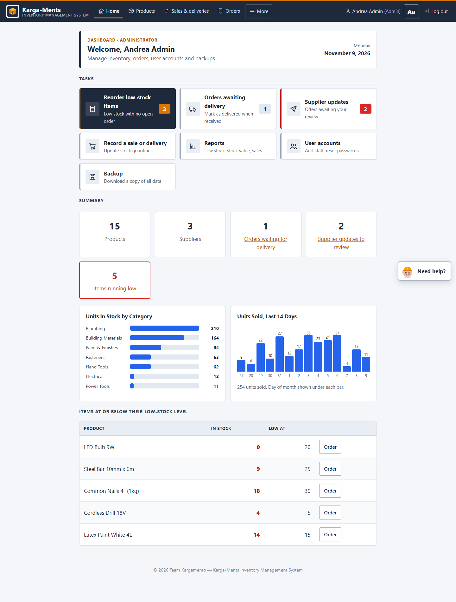
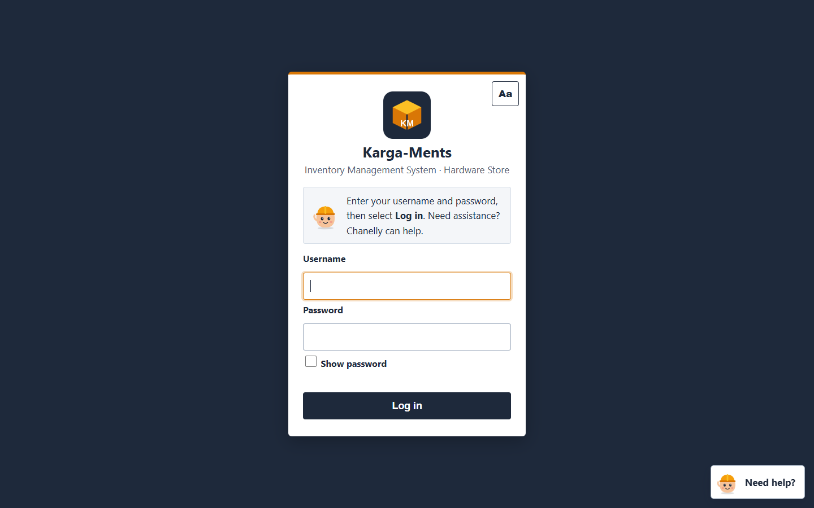
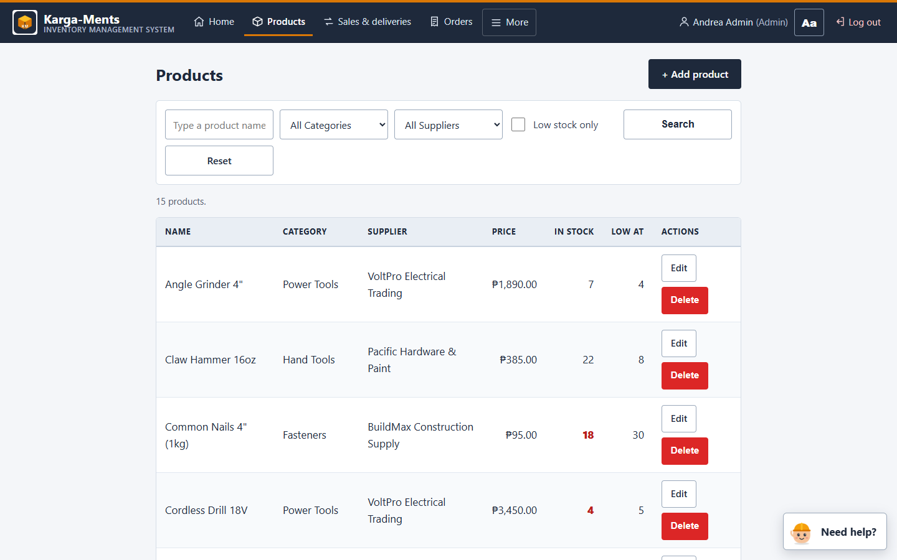
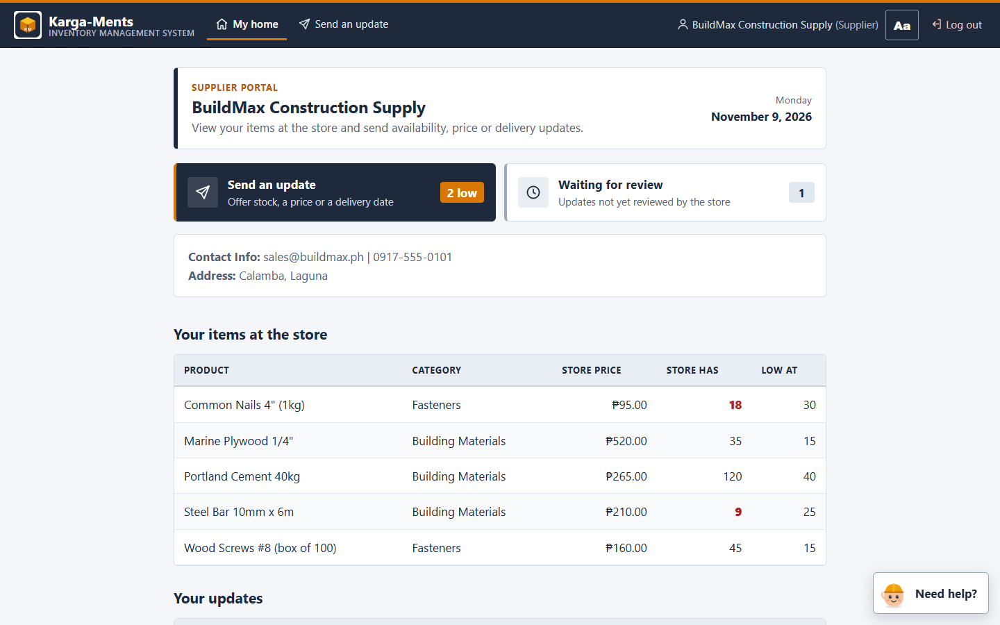
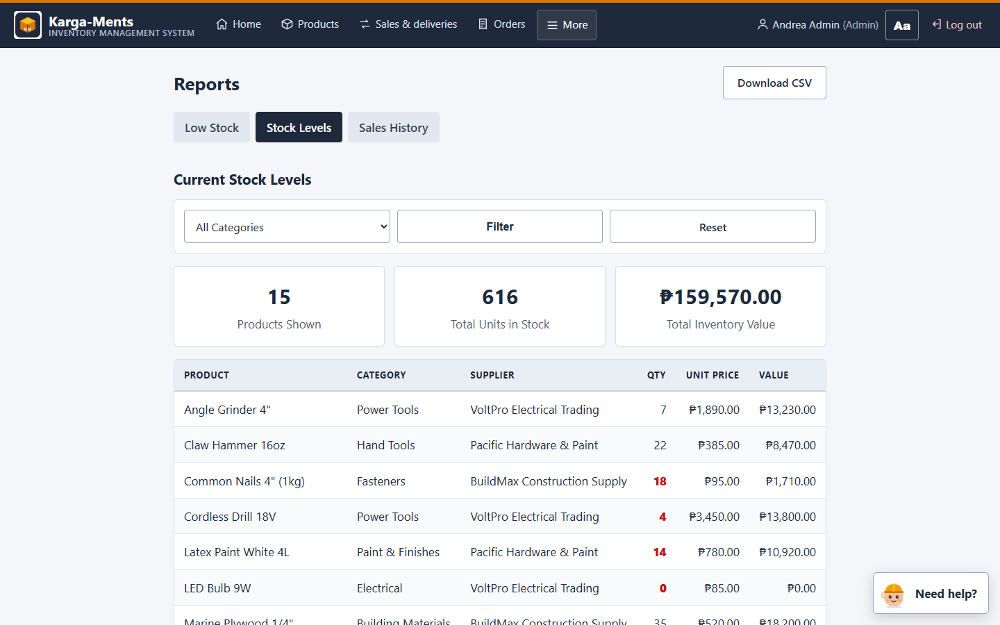
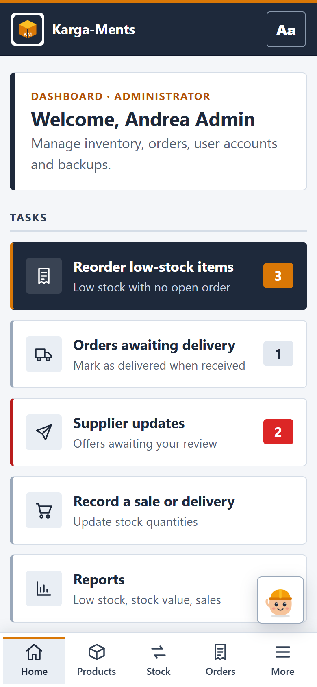

# Karga-Ments: Inventory & Supplier Management System

A web-based inventory system for a hardware store (cement, nails, tools, wire, paint). Staff track stock, sales and purchase orders, and suppliers use their own portal to offer stock. It's built with PHP and MySQL, deployed on Hostinger, and designed to be easy for non-technical users.

**🔗 Live site:** [YOUR-LIVE-LINK](https://YOUR-LIVE-LINK)

---

## Features

**Role-based access (4 roles)**
- **Admin:** manages users, categories, suppliers and products; downloads database backups
- **Manager:** creates purchase orders, reviews supplier offers, views reports
- **Employee:** records stock in/out and sales
- **Supplier:** separate **Supplier Portal** for submitting available stock, prices and delivery dates

**Inventory & orders**
- Product and category management (create, edit, delete) with minimum-stock thresholds
- Stock transactions (stock in, stock out, sales) with full history
- Purchase orders with line items and status tracking
- Supplier submissions that managers approve or reject

**Reports**
- Stock levels, low-stock alerts, sales history, and a full **audit log** of who changed what

**Built for everyday users**
- An "Aa" panel for bigger text, a Simple view and High-contrast mode, with settings saved per user
- Guided mode and a "Need help?" walkthrough on each page
- Large touch-friendly buttons and a bottom tab bar on phones
- Friendly "Are you sure?" confirmations showing totals before important actions
- A demo tour that resets the system to sample data for presentations

**Security**
- Passwords hashed with `password_hash()` / `password_verify()`
- All database queries use **PDO prepared statements** (protects against SQL injection)
- **CSRF tokens** on forms
- Each request re-checks the session: disabled accounts are logged out, and role changes take effect immediately
- Suppliers are locked inside the Supplier Portal
- `.htaccess` rules block folder listing and direct access to config files, SQL dumps and logs
- Admin database backup in pure PHP, which works on shared hosting

## Tech stack

| Layer | Technology |
|---|---|
| Backend | PHP 8 (PDO) |
| Database | MySQL / MariaDB, managed with phpMyAdmin |
| Frontend | HTML, CSS, vanilla JavaScript |
| Hosting | Hostinger (Apache/LiteSpeed); XAMPP for local development |

## Database design

11 tables: `Role`, `User`, `Category`, `Supplier`, `Product`, `Stock_Transaction`, `Purchase_Order`, `Purchase_Order_Item`, `Supplier_Submission`, `Audit_Log`, `User_Preference`.
The full schema with demo data is in [`karga_ments_hostinger.sql`](karga_ments_hostinger.sql).

## Screenshots

| Login | Products | Supplier Portal |
|---|---|---|
|  |  |  |

| Reports | Mobile view |
|---|---|
|  |  |

## Run it locally (XAMPP)

1. Copy the contents of `public_html/` into `C:\xampp\htdocs\karga-ments\`.
2. In phpMyAdmin, create a database named `karga_ments` and import `karga_ments_hostinger.sql`.
3. Open http://localhost/karga-ments/. Local settings are detected automatically.
4. Log in with a demo account (listed below).

---

**Developed by John Vincent Pangilinan** · [GitHub](https://github.com/6950xt) · [LinkedIn](https://www.linkedin.com/in/jvpangilinan)

---

# Deployment guide & changelog

### Upload to Hostinger (in this order)
1. **Database.** In hPanel go to Databases → MySQL Databases and create a database and user. Open the database in phpMyAdmin, then Import `karga_ments_hostinger.sql`.
   - Re-importing wipes the Karga-Ments tables. Download a backup first if the site has real data.
2. **Settings.** Open `public_html/config/config.php` and fill in the 3 `CHANGE_ME` lines (database name, user, password).
3. **Files.** Upload everything inside `public_html/` into your site's `public_html`. Keep the dotfiles (`.htaccess`).
4. **Your images.** Replace these two files, keeping the same names:
   - `assets/img/chanelly.png` (mascot, square PNG with a transparent background)
   - `assets/img/logo.png` (logo)
5. **Check it.** Log in as `admin` / `admin123`, then change the demo passwords in Users.

Demo logins: `admin`/admin123 · `manager1`/manager123 · `employee1`/employee123 · `supplier_buildmax`, `supplier_voltpro`, `supplier_pacific`/supplier123. The login `employee2` is disabled on purpose, to show that state.

### Which file to edit for each feature
| Feature | File |
|---|---|
| 1 Layout, home tiles per role | `index.php` (staff), `supplier_portal/dashboard.php` (suppliers), `assets/css/style.css` |
| 2 "Aa" panel (text size, Simple view, High contrast) | `assets/js/km.js` section 1; looks in `style.css` section 11; applied before drawing by `includes/prepaint.php` |
| 3 Plain words and menu icons | Menu: `includes/header.php` (`$kmNav`). Status words: `km_label()` in `config/config.php` |
| 4 Big buttons, phone tab bar | `assets/css/style.css` sections 4 and 10; tabs come from `$kmNav` in `header.php` |
| 5 "Are you sure?" pop-ups | Wording: `data-confirm…` on each button or form. Smart wording: `CONFIRM TEXT` in `km.js` |
| 6 "Need help?" steps | `HELP TEXT` in `km.js` |
| 7 Guided mode | Tips: `GUIDE RULES` in `km.js`. Numbers they use: `includes/guide_state.php`. Saved on: table `User_Preference` |
| 8 Demo tour | Chapters and steps: `DEMO TOUR` in `km.js`. Reset logic: `includes/demo.php`. Actions: `api/demo.php` |
| 9 Demo data | `includes/demo_seed.sql` (used by demo resets), the same data as the SQL file |
| 10 Cache safety | `asset()` and `APP_VERSION` in `config/config.php` |

### Demo mode (presenting)
- Log in as Admin, tap **Aa**, then **Start the demo tour**.
- This **resets all data** to the demo data.
- Account passwords and any staff accounts you created yourself are kept.
- When the site holds real data, set `DEMO_MODE` to `false` in `config/config.php`.

### Flaws found and fixed
- The demo stock history did not add up to each product's quantity. It now matches exactly.
- The demo data was grocery items. It is now hardware: cement, nails, tools, wire, paint.
- Re-importing the SQL failed if the tables already existed. It now replaces them cleanly.
- Raw "Access denied" / "Invalid token" text pages are now friendly pages with a way back.
- Recording a sale, approving or rejecting a submission, and sending an order had no confirmation. Browser popups were plain. All of these now use the friendly Yes/No pop-up, which shows the totals.
- Double-clicking a button could send a form twice. The buttons now lock after the first click.
- Buttons were 25–30px high and text was 12–14px. Everything is now 44px+ and 17px+.
- On phones the 11 menu links wrapped into a block. Phones now get a bottom tab bar plus a More sheet.
- CSS and JS were not versioned, so phones could keep showing old styles. Each upload now refreshes them.

Needs PHP 8.0 or newer. Pick 8.1 or 8.2 in hPanel.
